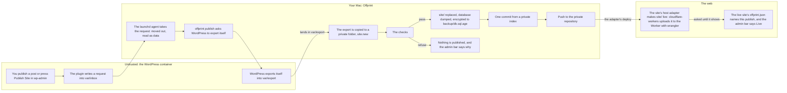

# Offprint

Offprint runs WordPress on your Mac and publishes a static copy of it to the web.

The point is to write in the WordPress block editor. There is no PHP site, database or login page on the internet:
WordPress runs only on your Mac, and the public site is only files. The name is from printing: an offprint is a
separately printed copy of an article, taken from the main run.

This is an exploration, by one person, on one Mac. It runs two real sites. There is no release tag yet.

## How it works

1. **Ask.** You publish a post, or press Publish Site in wp-admin (or type `offprint publish`).
2. **Export.** WordPress, in Docker on your Mac, is crawled from the inside as a logged-out visitor: the home page, the
   feed, `robots.txt`, the sitemaps, and every link from there.
3. **Check.** On the Mac, outside the container: no link to `wp-admin`, the login page, XML-RPC or the REST API, no
   local address, and within the host's limits. If a check refuses, nothing is published and the admin bar says why.
4. **Back up and commit.** The database is dumped and encrypted with `age`. The static copy, `wp-content/` and the
   backup go into one commit in the site's own private repository, which is pushed.
5. **Deploy.** The site's host adapter makes that commit live.
6. **Confirm.** The publish asks the live site which publish it is serving, and says "Live" only when it names this
   one.

The tool is this repository. A site is a separate folder and its own private git repository; the tool never holds a
site's content. [docs/how-it-fits-together.md](docs/how-it-fits-together.md) has the full diagrams and every step in
detail.

## What works today

- macOS only: the host set-up, the launchd agent and the Keychain are the Mac's.
- A new site folder (`offprint new`), the Mac set-up (`host-setup`, `host-undo`) and the local WordPress in Docker
  (`setup-wp`).
- Publishing: export, check, commit with an encrypted database backup, push, deploy, confirm.
- A launchd agent that publishes when WordPress asks (`install-agent`).
- Three ways to host: Cloudflare Workers (`cloudflare-workers`, uploaded from your Mac); no host at all (`none`, where
  a publish ends at the push); or an adapter of the site's own, for a host that deploys when the repository is pushed.
- Checking and restoring the backup (`offprint backup verify`, `offprint backup restore`).

## What doesn't

- Not built: a top-level `setup`, `doctor` and `upgrade`; an adapter for a server you run over SSH; pinning a site to
  an exact Offprint version; anywhere to send the backup but the site's own repository.
- Comments need a web server of your own in front of the site and a second small machine beside it; on a host
  that only takes files they are closed, and a form has nowhere to post (the export warns). The whole of it is built
  and has run with the real programs in Docker, not yet on a real server:
  [what is built](docs/reference.md#comments-pigeonhole-what-is-built). Search, and any page address
  with a query string, is not exported. Only the main feed is.
- Every publish crawls the whole site again. A page that is in no sitemap and linked from nowhere is missed.
- `wp-content/` (uploads, themes, plugins) is committed as it is; only the database backup is encrypted.

## Why it treats its own WordPress as untrusted

WordPress runs themes and plugins you did not write, and its container can write three folders of the site:
`wp-content/`, `var/export` and `var/inbox`. So nothing it writes is ever run, sourced or followed by Offprint. The
checks that decide what is published run on the Mac, on a private copy WordPress cannot reach. A host's token lives in
the login Keychain, never in a file. The database backup is encrypted to a key only you hold.

Not protected: your Mac from you. Whoever controls the Mac controls everything, and the folders on your PATH outside
the site folder are yours to keep clean. [docs/security.md](docs/security.md) lists what could go wrong and what stops
each.

## Get started

[docs/getting-started.md](docs/getting-started.md): a checklist of what you need, then eight steps from cloning this
repository to a published site.

## More

- [docs/getting-started.md](docs/getting-started.md): the steps, including the backup key a publish needs.
- [docs/reference.md](docs/reference.md): `site.json`, [the database backup](docs/reference.md#the-database-backup)
  and restoring it, every command, [Cloudflare Workers](docs/reference.md#publishing-to-cloudflare-workers) and
  [other hosts](docs/reference.md#a-sites-own-adapter), the one privileged step, sitemap plugins, the tests.
- [docs/security.md](docs/security.md): what could go wrong, and what stops it.
- [docs/how-it-fits-together.md](docs/how-it-fits-together.md): what lives where, and a publish, drawn.
- [docs/orientation.md](docs/orientation.md) and `CLAUDE.md`: for a coding agent working on Offprint itself.

## Licence

GPL-2.0-or-later. See `LICENSE`.
