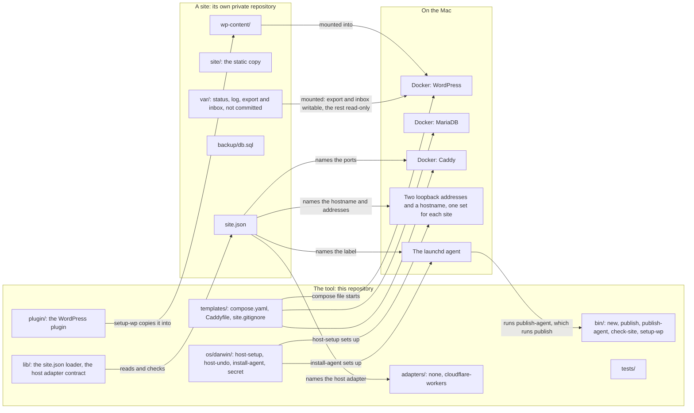
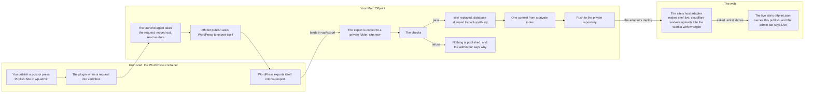

# Offprint

Offprint runs WordPress on your Mac and publishes a static copy of it to the web.

The point is to write in the WordPress block editor. There is no PHP site, database or login page
on the internet: WordPress runs only on your Mac, and the public site is only files. Everything WordPress writes is
treated as untrusted, and a publish checks it before anything leaves the machine. The name is from printing: an offprint
is a separately printed copy of an article, taken from the main run.

> What works today. Offprint runs on macOS only: the host set-up, the launchd agent and the Keychain that holds a
> host's token are the Mac's. Built: a new site folder with its `site.json` (`offprint new`), the Mac set-up
> (`host-setup`, `host-undo`), the local WordPress in Docker (`setup-wp`), the publishing pipeline (export, check,
> commit with a database backup, push), the launchd agent that publishes when WordPress asks (`install-agent`), and two
> host adapters: `cloudflare-workers`, which uploads the site to a Cloudflare Worker from your Mac (set up with
> `offprint adapter setup`, checked with `offprint adapter doctor`), and `none`, for a site with no host, where a
> publish ends at the push. Not built yet: a top-level `setup`, `doctor` and `upgrade`; an adapter for a server you run
> over SSH; and pinning a site to an exact Offprint version. A site uses whichever Offprint you run, and keeps the copy
> of the plugin that `setup-wp` committed until you replace it (see `setup-wp` under Commands); a publish commits no
> plugin but the one of the Offprint you run, so after an upgrade that changes the plugin it refuses until you do.

## How the pieces fit



The tool is this repository: the scripts, the host adapters, the WordPress plugin, the Docker templates and the tests.
It never holds a site's content, uploads or database dump. A site is a separate folder and its own private git
repository. It holds `site.json`, `site/` (the static copy), `wp-content/`, `backup/` (the database dump), `var/`
(status, log, export and inbox; not committed) and `local/certs/` (the local TLS certificate; not committed). Run
`offprint` from inside a site folder, or set `OFFPRINT_SITE` to it. More in
[docs/how-it-fits-together.md](docs/how-it-fits-together.md).

## A publish, start to finish



1. You publish in wp-admin, or press Publish Site. The plugin writes a request into `var/inbox`, and the launchd agent
   (once `offprint install-agent` has installed it) moves it out and reads it as data. The agent runs
   `offprint publish`.
2. WordPress (in Docker, on this Mac) is told to export itself; the exporter runs in the container and writes
   `var/export`. The export is copied to a private folder, `site.new`: WordPress can still write `var/export`, so only
   the private copy is checked and published.
3. `bin/check-site` checks the copy: no local address, no admin, login, XML-RPC or REST links, no symlinks, no git
   files, none of the files the publish or the host writes at the root (for Cloudflare: `offprint.json`, `_headers`
   and `_redirects`), nor one the host would read as its own (`.assetsignore`, `_worker.js`), and the host's limits.
   If it refuses, nothing is published and the admin bar says why.
4. `site/` is replaced by the copy, and the database is dumped to `backup/db.sql`.
5. One commit is made of `site/`, `wp-content/` and `backup/`, with `git commit-tree`, so no commit hooks run. It is
   refused unless the plugin in it is exactly this Offprint's own.
6. The commit is pushed to `origin`. Then the site's host adapter makes it live: `cloudflare-workers` uploads exactly
   the committed `site/` to the Worker, from this Mac, with wrangler. The publish asks the live site for its
   `offprint.json` until it names this publish (for Cloudflare, for 60 seconds at most), and then says Live. With no
   host set up (the adapter `none`), the publish ends at the push: "Saved".

Progress is in `var/status.json` (shown in the WordPress admin bar) and `var/publish.log`.

## Why it treats its own WordPress as untrusted

WordPress, its plugins and themes, and whatever they write are untrusted. The container can write `wp-content/`,
`var/export` and `var/inbox` and nothing else. Nothing it writes is sourced or followed, and Offprint never runs it by a
lookup of its own: before anything is looked up on the PATH, every Offprint command leaves out of it each entry that is
the site folder or inside it, and each that names no fixed folder (`.`, an empty or a relative entry), saying so, and
each that can't be entered when it starts (the last row below); it keeps each of the rest as the folder it leads to
then, not as its name. The rest of the PATH is yours: a program in an absolute entry outside the site folder runs as
you, as it would for any command you run.

| What could go wrong | What stops it |
| --- | --- |
| WordPress keeps writing the export while it is checked. | Only a private copy, `site.new`, is checked and published. |
| A plugin plants a `.git` folder, or a `.gitattributes` or `.gitmodules` file, to make git run its commands or change how files are stored. | The checks refuse them in the export, and a publish refuses a git repository inside `wp-content`. Git runs with `core.fsmonitor=false` and, where it supports it, takes attributes from the empty tree, not from files on disk. |
| A plugin's own `.gitignore` silently drops files from the published site. | The commit is built from a private index, and the publish refuses if anything would be left out (WordPress's cache and upgrade folders and `debug.log` excepted). |
| WordPress changes Offprint's plugin, which it runs from its copy in `wp-content/mu-plugins/` and can write there, so that a publish commits the change with the rest of `wp-content/`. | A publish refuses uncommitted changes to the copy before the export, and, once the commit is built, refuses unless the plugin in it is exactly this Offprint's own `plugin/`: each file's bytes and executable bit, and no other file. It names the first path that differs and says what to do; nothing is committed. A dry run compares the copy on disk the same way, never through a link. Not stopped: WordPress can still change the copy it runs between publishes, and another plugin in the same PHP process can change what the exporter writes; that is why the checks on the Mac, which read only the private copy, are the gate. |
| A page links to `wp-admin`, `wp-login.php`, XML-RPC or the REST API, or mentions the local hostname. | `bin/check-site` refuses. |
| WordPress writes a file the Mac later reads: a `site.json` in `wp-content`, or a bad publish request. | A `site.json` inside another site folder is refused. A request is moved out first, must be a plain file of at most 1 KB, and only its first 200 bytes are read, as data. |
| The repository holding `backup/db.sql` (drafts, password hashes) and every upload is public. | `offprint publish` asks `gh` and refuses to push. If `gh` is missing or does not answer, it warns instead. |
| What wrangler prints goes to `var/publish.log`, which WordPress can read: the token, should it ever print it; and, when Cloudflare refuses the token for the account, the name and id of every account the token can see (a real account's name held its owner's email address), and, when the token lacks User Details Read, who is logged in. | The adapter's filter replaces the token's value with `[token hidden]`. It leaves out, on every stream, each line that starts (after any spaces) with a box-drawing character of a table (`┌ │ ├ └`) or with 👋, and everything from a line that is exactly "Getting User settings..." to the end of the table that follows it (to the end of that stream when the table never closes). It writes one line in place of what a stream had left out. Nothing else of wrangler's is left out: a line that only holds those words (an uploaded file's name) is kept. |
| Another site or service already uses an address, host name, port, launchd label or Docker compose project. | `host-setup` refuses before changing anything, and every command that runs Docker compose refuses a project that is not this site's. |
| A program WordPress put in `wp-content/` or `var/` is found on the PATH: through `.`, an empty or a relative entry (each is whatever folder a command runs in), or an entry that is in the site folder, or leads into it through links, when the command looks it up. It would run as you, so it could read the Keychain item itself. | Every Offprint command starts `#!/bin/bash` and runs the tool's other scripts with `/bin/bash`, never a bash the PATH finds. Before anything is looked up on the PATH, it leaves out each entry that is empty, relative, or in the site folder or leads into it, says which in one line, and never leaves the PATH empty (`/usr/bin:/bin:/usr/sbin:/sbin` when nothing is left). The site folder is the one it is run in or below, or `OFFPRINT_SITE` (for `host-setup` and `host-undo`, also the folder named on their command line), and inside is asked of the disk. An entry `~` or `~/...` is your `HOME`'s, as bash takes it, when `HOME` is an absolute path with no colon in it; otherwise it is left out, and named. It also leaves out, without a word, each entry that can't be entered when it starts (not there, a link to nothing, a folder closed to you): it runs nothing then, and nothing made or opened there later can be reached through it. One that leads to a folder with a colon in its name (a Finder name with a `/` in it, say) is left out too, as a colon can't be written in a PATH, and named, with that reason. Each entry it keeps is kept as the folder it leads to then, on disk, not as its name; so is `TMPDIR`, which is refused when it is in the site folder or can't be entered. So a link on the way that WordPress points elsewhere later changes nothing. As a second layer, set-up, doctor and a publish never run a node, npm or wrangler in the site folder, nor hand the token to a curl or Cloudflare's answer to a php there. Not stopped: an absolute entry outside the site folder (another site's `wp-content/`, say) is yours to keep clean, as for any command. And at the moment of the check, a link in a folder WordPress can write, on the way of an entry or of `TMPDIR`, can make it lead to any folder outside the site folder that is there at that moment, another site's folders (its `wp-content/`, say) included: a PATH or `TMPDIR` that passes through the site folder is your choice. |

Each of these exists because a review broke the version before it.

## Try it

This gets you a local WordPress and a checked, committed static copy of it; step 5 then puts that copy on a Cloudflare
Worker, and step 6 lets WordPress ask for a publish by itself.

You need, on your Mac: git, with `user.name` and `user.email` set; php 8.1 or newer (`brew install php`; the
tool's own PHP tests need 8.3); Docker with Compose, running (Docker Desktop is what Offprint has been used with;
other Docker set-ups are untried); mkcert (`brew install mkcert`), with `mkcert -install` run once; and an
administrator account, for the one `sudo` step. To publish: a private GitHub repository for the site, and GitHub's `gh`, signed in
(`gh auth login`), so that a publish can check the repository is private (without `gh` it only warns). For Cloudflare:
a Cloudflare account, and node 22.12.0 or newer, with its npm.

Get your copy of this repository with `git clone https://github.com/richardtape/offprint.git`, in a folder that is
not inside any site. `offprint` here is `bin/offprint` in that copy: run it by its path, or put a link to it in a
folder on your PATH (it follows the link to find the rest of the tool). Every step after the first runs in the new
site folder.

1. `offprint new mysite` makes the site folder `mysite` in the folder you run it in, outside every other site folder
   and git repository: the top of its own git repository, on `main` (a publish refuses a site folder that is not),
   holding `site.json` (see the Reference below) and the tool's ignore list for a site, `.gitignore`, committed as "A
   new site". The name is the site's Docker compose project name, so it is refused when Docker has a project of that
   name, or a volume called `NAME_db` or `NAME_wordpress` (when Docker can't be asked, it says so and goes on:
   `setup-wp` asks again before it starts anything).

   It asks for one thing, the public address (`--public-url URL` answers it without a prompt): the address the site
   will be served at. Every link in the published copy points there, so settle it now: WordPress takes it when its
   container is made (step 3). To publish to Cloudflare Workers (step 5), that is the Worker's address: its
   `workers.dev` address, say, `https://my-site.SUBDOMAIN.workers.dev`, with your account's `workers.dev` subdomain,
   which Cloudflare's dashboard shows.

   It picks the rest so that no site whose host set-up is done (step 2) has them: `local_host` is `NAME.local`
   (refused when `/etc/hosts` names it already); `local_ip4` is `127.0.0.N`, the lowest N from 2 that is neither on
   `lo0` nor in `/etc/hosts` and whose two ports nothing listens on; `local_ip6` is `fdXX:XXXX:XXXX::N`, a unique-local
   prefix of 40 random bits made for this site, and the same N; and the ports are `4000 + 100 × N + 43` (`tls_port`)
   and `+ 80` (`http_port`). It reads no other site's folder: a site made with `new` whose `host-setup` hasn't run yet
   is not on `lo0`, in `/etc/hosts` or listening, so the next `new` can pick the same values. Run step 2 for each site
   before you make the next. When `lo0`, `/etc/hosts` or the ports can't be read, it says so and goes on. `host-setup`
   checks every value again and refuses a clash; then change `local_ip4`, the last group of `local_ip6` and the two
   ports in `site.json` by hand (to another N's, say), and run it again. It ends by saying what it wrote and what is
   left:

   ```
   $ offprint new mysite --public-url https://www.example.com
   Made mysite: a git repository on main, holding site.json and .gitignore, committed as "A new site".
   In its site.json:
     name        mysite
     public_url  https://www.example.com
     local_host  mysite.local
     local_ip4   127.0.0.2
     local_ip6   fd12:3456:789a::2
     tls_port    4243
     http_port   4280
   Next, in this order:
     cd mysite
     offprint host-setup          (prints the sudo line to run)
     offprint setup-wp
     offprint publish --dry-run
   Run offprint host-setup for this site before making another: until then its address and ports are not yet taken on this Mac.
   To publish to a host, add an adapter block to site.json: see the README.
   ```

   Without a git identity (`git config user.name` and `user.email`) the two files are left uncommitted, and it says
   the two commands that commit them.
2. `offprint host-setup --print` shows what the host set-up would do. `offprint host-setup` then prints the `sudo`
   line that does it; run that line.
3. `offprint setup-wp` makes the local WordPress, and copies the plugin into `wp-content/mu-plugins/`. It needs Docker
   running and `mkcert` (with `mkcert -install` done), and asks for an admin user name, email address and password.
   It then takes away the two traps of a first publish, saying so in a line each: on the WordPress it has just
   installed, it deletes WordPress's "Sample Page" (post 2, untouched), which links to `/wp-admin/`, a link the checks
   refuse; and it commits the plugin, alone, as "Offprint's plugin" (a publish refuses while the plugin copy has
   uncommitted changes, and commits no plugin but this Offprint's own). When it can't commit it (no git identity, or
   something else staged), it says what to do. It ends with
   "Done: https://mysite.local/  (admin: https://mysite.local/wp-admin/)".
4. `offprint publish --dry-run` exports and checks the site, changing nothing else. Then `offprint publish --no-push`
   commits it.
5. To publish, give the site an `origin` it can push to: a private repository, as the publish refuses a public one
   (`gh repo create mysite --private --source=. --remote=origin` makes one on GitHub). With no `adapter` block,
   `offprint publish` then commits and pushes, and ends "[saved] Committed and pushed ...": the site has no host. To
   publish to Cloudflare Workers, add an `adapter` block to `site.json` naming the Worker (the one `public_url` is the
   address of) and your Cloudflare account's id (a publish makes the Worker if there is none of that name):

   ```json
   "adapter": {"name": "cloudflare-workers", "worker": "my-site", "account_id": "0123456789abcdef0123456789abcdef"}
   ```

   Commit `site.json`. Then `offprint adapter setup` (see
   [Publishing to Cloudflare Workers](#publishing-to-cloudflare-workers)): it asks before each step, and you paste the
   API token at its prompt. `offprint adapter doctor` checks it all; its last three lines are about the live site, so
   until the first publish its lines about `offprint.json` and `/feed/` are problems (a publish writes `offprint.json`,
   and the rules that serve the feed at `/feed/`). Set-up and doctor show that Cloudflare knows the token and it can
   see the account, not that it may upload: the first publish shows that. `offprint publish` then publishes, and ends
   with "The site is live at ..." (a first publish to a new Worker takes about 20 seconds); or, when Cloudflare
   refuses the upload, with its reason and what to do (a token without Account → Workers Scripts → Edit gets "No
   access to the specified service.").

   If you change `public_url` after step 3, commit `site.json` and run `offprint compose up -d`: WordPress takes the
   address when its container is made, and this makes the container again with the new one. Until then a publish
   would link every page to the old address; `offprint adapter doctor` says when the two differ.
6. `offprint install-agent`, run as you (not with `sudo`), installs the launchd agent. From then on, publishing a post
   or page in wp-admin, changing, unpublishing or deleting a published one, or editing or deleting a category or tag,
   asks the agent to run `offprint publish`; anything else (menus, widgets, themes, settings) waits for the Publish
   Site button in the admin bar, which also shows how each publish went. The agent's PATH is Homebrew's folders and
   the system's, and `docker`, `git` and `php` must be on it (`INSTALL_AGENT_PATH` gives it another); Docker must be
   running when it publishes. `offprint install-agent --print` shows the agent's plist and changes nothing; `--remove`
   takes the agent away.

## Reference

### site.json

`site.json` is data. `lib/config.php` is the only code that parses it. It must be a JSON object of at most 64 KB, not a
symlink, with no repeated key and no key that is not in the table. Every problem is reported at once, one line each,
starting `site.json: "<field>"`.

| Field | Required | Rule | Default |
| --- | --- | --- | --- |
| `format` | yes | The integer 1. A higher number is refused as newer than this Offprint. | none |
| `name` | yes | Lowercase letters, digits and dashes, starting with a letter, at most 31 characters. Not `offprint-e2e`. It is the Docker compose project name. | none |
| `public_url` | yes | `https://` and a lowercase hostname: no port, path or trailing slash. | none |
| `local_host` | no | A lowercase hostname with at least one dot, different from the public host. | `wp.local` |
| `local_ip4` | yes | `127.a.b.c`, each part 0-255, no leading zeros, not `127.0.0.1`. | none |
| `local_ip6` | yes | A unique-local `fdXX:...` address with `::` before its last group, lowercase, in canonical form, like `fd00::9`. | none |
| `tls_port` | yes | A JSON integer, 1024 to 65535. | none |
| `http_port` | yes | A JSON integer, 1024 to 65535, different from `tls_port`. | none |
| `agent_label` | no | Letters, digits, dots and dashes, starting with a letter or digit, at most 100 characters. | `local.offprint.NAME.publish` |
| `daemon_prefix` | no | The same rule as `agent_label`. | `local.offprint.NAME` |
| `adapter` | no | The site's host adapter: an object, `{"name": "NAME", ...}`. NAME is lowercase letters, digits and dashes, starting with a letter, at most 41 characters: an adapter in the tool's `adapters/`, or else in the site folder's own `adapters/`, committed. Its other keys are the adapter's settings, at most 20, each named with lowercase letters, digits and underscores, starting with a letter, at most 41 characters, and each a string of 1 to 200 letters, digits and `. _ : / @ + = -`, or an integer from 0 to 2147483647; the adapter checks them itself. | `{"name": "none"}` |

A hostname is at most 253 characters, each label at most 63. An example:

```json
{
  "format": 1,
  "name": "example",
  "public_url": "https://www.example.com",
  "local_host": "mysite.local",
  "local_ip4": "127.0.0.9",
  "local_ip6": "fd00::9",
  "tls_port": 4999,
  "http_port": 4998
}
```

### Commands

`offprint help` prints this list:

```
usage: offprint COMMAND [ARGS...]
  offprint new NAME [--public-url URL]       make a new site folder, NAME, here: its site.json (with addresses and
                                             ports no other site set up on this Mac uses) and .gitignore, committed
  offprint publish [--dry-run] [--no-push]   export the site, check it, commit it with a backup, push it, and have
                                             its host adapter make it live
  offprint agent                             what launchd runs when WordPress asks for a publish
  offprint wp ARGS...                        WP-CLI in the site's WordPress (offprint wp option get home)
  offprint compose ARGS...                   docker compose for the site (offprint compose up -d)
  offprint setup-wp                          make the site's local WordPress
  offprint install-agent [--force] [--remove | --print]
                                             the launchd agent that publishes when WordPress asks (yours, not root's)
  offprint host-setup [--print] [--adopt]    give the site its addresses, name and ports 443/80 on this Mac (as root:
                                             it prints the sudo line to run; --print shows every change, as you;
                                             --adopt: the same site, moved to a new folder, takes its set-up over)
  offprint host-undo [--print]               take this site's host set-up away again, and nothing else
  offprint check DIR                         run the export checks on DIR, as a publish runs them (the site's hosts,
                                             and its adapter's file names and limits)
  offprint adapter setup [--yes]             set up on this Mac what the site's host adapter needs (each step says
                                             what it will do, and asks first; --yes: yes to each)
  offprint adapter doctor                    check what the site's host adapter needs, and the live site: one ok or
                                             problem line each, changing nothing (exit 0 only when all are ok)
  offprint help                              this list
```

`new` runs outside every site folder, and makes nothing outside the folder it runs in. It refuses, in one line and
before anything is made (exit 2): a name `site.json` would refuse, `offprint-e2e`, or one ending in a dash (`NAME.local`
couldn't be a host name); a `./NAME` that is there already, of any kind; a folder inside a site folder or a git
repository; no `git` or `php` on the PATH; a name Docker has a compose project or volume of, or that `/etc/hosts`
names as `NAME.local`; no public address (with stdin not a terminal, `--public-url` is needed: this one prints the
usage line, then its one line). It makes the folder under a private name beside `./NAME` (`.NAME.new.XXXXXX`), checks
`site.json` with `lib/config.php` (a public address it refuses: its line, exit 2), commits, and only then renames it;
on a failure (exit 1) or Ctrl-C it removes it, so it leaves a whole site folder or nothing. It commits only with an
identity git has been given (`user.name` and `user.email`), never one git would guess from this Mac's user and host
names.

`setup-wp` needs `mkcert` (with `mkcert -install` done) and Docker. It asks for an admin user name, email address and
password, or reads `WP_ADMIN_USER`, `WP_ADMIN_EMAIL` and `WP_ADMIN_PASSWORD`. The password is never stored. On a
WordPress it has just installed (WP-CLI said "Success:"; never one it found installed), it deletes post 2 when that is
WordPress's untouched Sample Page (a page with the slug `sample-page`, its `post_modified` its `post_date`). On any
run, when HEAD doesn't have the plugin yet, it commits exactly `wp-content/mu-plugins/offprint.php` and
`wp-content/mu-plugins/offprint` as "Offprint's plugin" when the site folder is the top of its git repository, nothing
is staged and git has an identity; else it says what to do. What it commits is the tool's own `plugin/`, byte for
byte, never the copy in `wp-content/`, which WordPress can write: when the copy then differs from the commit (a file
WordPress changed or added there), it says so, naming the paths, and a publish refuses until the copy matches. A
plugin in HEAD that isn't this Offprint's (an older one) is left as it is, and it says the command that would replace
it (a publish refuses until it is replaced, and says the same command). Every command that runs Docker compose
(`setup-wp`, `compose`, `wp`, `publish`) first asks Docker about the compose project of the site's `name`, and refuses to go on (exit 2, naming what it found) if a container of that
project was made from another folder, or if a volume of that project, or a volume called `NAME_db` or `NAME_wordpress`
(the names compose would mount) however it was made, lacks either label Offprint gives its own: `offprint=1` and
`com.docker.compose.project=NAME`.
When Docker isn't running, `setup-wp`, `wp` and `compose` (but for `compose ps`) say so and stop; `publish` fails with
"WordPress isn't running".

Without `--no-push`, a publish needs the site repo on `main` and an `origin` it can reach: it asks `origin` about `main`
before it exports anything, and with none it stops ("Couldn't reach GitHub to check main; see var/publish.log"). With
one it commits and pushes, then has the site's host adapter make the commit live, and asks the live site until it
serves this publish (for `cloudflare-workers`, 60 seconds at most); with no host set up it ends once it has pushed.
`--no-push` stops after the commit, on any branch.

### Publishing to Cloudflare Workers

The `cloudflare-workers` adapter uploads `site/`, exactly as committed, to a Cloudflare Worker's static assets, from
your Mac, with wrangler 4.166.0. The publish writes `offprint.json` into `site/`, naming the publish, and then asks
`PUBLIC_URL/offprint.json` until it names it. Its two settings, both required: `worker`, the Worker's name (1 to 63
lowercase letters, digits and dashes, starting and ending with a letter or digit), and `account_id`, the Cloudflare
account's id (32 lowercase hex digits).

A publish downloads and installs nothing: `offprint adapter setup` puts what it needs on the Mac first. Each step says
what it will do and asks first (`--yes` answers yes to each), and nothing is made on Cloudflare:

1. node, 22.12.0 or newer: the `node` first on your PATH. Its full path is recorded, since the launchd agent that
   publishes doesn't have your shell's PATH.
2. wrangler 4.166.0, installed with `npm ci --ignore-scripts` from the lockfile in `adapters/cloudflare-workers/`, by
   the npm beside that node, with none of your own npm settings, in a new folder that takes its place only once it is
   whole.
3. a Cloudflare API token, made at https://dash.cloudflare.com/profile/api-tokens (Create Token, then Create Custom
   Token) with the permission Account → Workers Scripts → Edit for that account. Set-up asks Cloudflare for the
   account's list of Workers with it, and only then keeps it in your login Keychain, never in a file. Cloudflare's
   answer shows it knows the token and the token can see the account; not that it may upload (it answers so for a
   token without the Workers permission too), which only a publish shows, so set-up says just that. A token Cloudflare
   doesn't know (HTTP 401: mistyped, cut short when copied, deleted or rolled) is told apart from one it refuses for
   the account (403: most often a wrong `account_id`, else a token for another account) and an account it doesn't find
   (404: `account_id`). A value in the Keychain that can't be read (one stored some other way) is replaced by the one
   you paste.

node's path and wrangler go in `~/Library/Application Support/Offprint/cloudflare-workers/` (`OFFPRINT_HOME` moves
`~/Library/Application Support/Offprint` elsewhere). An `OFFPRINT_HOME` set in your shell when you run set-up is not
in the launchd agent's plist (`offprint install-agent` gives it only `PATH` and the site folder), so a publish from
wp-admin looks in the default folder, finds nothing there, and fails saying to run set-up: for a site the agent
publishes, leave `OFFPRINT_HOME` unset. Run set-up again at any time: what is already right is kept, and nothing is
asked about it. Ctrl-C stops it, leaving nothing half-installed and no token stored.

A publish reads the token from your login Keychain only to upload, after the push. When the Keychain is locked, the
deploy fails, saying so ("the login Keychain is locked, so the Cloudflare token couldn't be read; unlock it, then
publish again"), and nothing is uploaded. A publish started by the launchd agent while the login Keychain is locked
has been tested with stand-ins only, not on a real locked Keychain.

`offprint adapter doctor` changes nothing. It prints one line, `ok` or `problem`, for each of: wrangler 4.166.0
installed; the node recorded runs; Cloudflare knows the token in the Keychain and it can see the account (whether it
may upload, a publish shows); WordPress's container was made with site.json's `public_url` (as Docker records it); the
live site's `offprint.json` names the publish of the site repo's last commit; `/feed/` answers as RSS; and a page that
isn't there answers 404. A `problem` line ends with what to do. It exits 0 only when every line is `ok`.

When Cloudflare refuses an upload, the publish fails with the line after wrangler's `[ERROR]` marker and Cloudflare's
own reason under it (looked for only in that marker's own block, up to the next marker or wrangler's `Getting User
settings...` line), and, for the two a real run gave, what to do: "No access to the specified service." (the token
lacks Account → Workers Scripts → Edit for the account) and "Authentication error [code: 10000]" (`account_id` isn't
an account the token belongs to, or the token lacks the permission; `offprint adapter doctor` tells which). It fits in
the status's 300 bytes: when it doesn't, the API path in wrangler's line goes first, then what to do (all of it, never
a part), then the end of wrangler's line. What wrangler prints is in `var/publish.log`, with the token's value hidden,
and without the lines that name accounts (names and ids) or the owner that wrangler prints when Cloudflare refuses the
token: one line per stream says something was left out.

Every Offprint command has left out of its PATH, before anything is looked up on it, each `.`, empty or relative entry,
each entry in the site folder, each that leads to a folder with a colon in its name, and each that can't be entered, and
kept the rest as the folders they lead to then (the security table above). As a second layer, set-up, doctor and a
publish never run a node, npm or wrangler, nor hand the token (or Cloudflare's answer) to a curl or php, that is in the
site folder or leads there by a link; and set-up and doctor ignore the PATH's empty and relative entries when they look
those up. The Keychain helper (`os/darwin/secret`), which holds the token, is run with `/bin/bash` and runs
`/usr/bin/security`, never a bash or a security the PATH finds. Every other command Offprint runs is the one the rest of
the PATH finds first: a program in an absolute entry outside the site folder runs as you, so keep those folders yours.

### The one privileged step

`offprint host-setup`, with `offprint host-undo`, which reverses it, is the only thing in Offprint that runs as root,
and you run it by hand: it does not call `sudo`, it prints the line to run. `offprint host-setup --print` runs as you,
changes nothing, and lists every change and any clash. The set-up has four parts, all this site's: `local_ip4` and
`local_ip6` on `lo0`; both again at every boot (the LaunchDaemon `PREFIX.loopback`, PREFIX being `daemon_prefix`);
`local_host` as both addresses in a marked block of `/etc/hosts`, copied once to `/etc/hosts.before-offprint` first;
and ports 443 and 80 on both addresses relayed to the site's Caddy (`PREFIX.https`, `PREFIX.http`). It refuses,
naming the clash, before changing anything when an address, the host name, a port or a LaunchDaemon is already in use
by something else. Everything it writes carries a stamp, the sha256 of the site folder's physical path, and one
without this folder's stamp is never changed or removed. For a site moved to a new folder, `host-setup --adopt`
re-stamps that site's own set-up and nothing else; running it says that the old folder is gone and this is the same
site. `offprint host-undo` (also with `--print`) takes this site's set-up away again, and nothing else;
`/etc/hosts.before-offprint` is never removed.

### Tests

| Suite | Command | Needs Docker | In CI |
| --- | --- | --- | --- |
| PHP (exporter, plugin) | `composer install && vendor/bin/phpunit` | no | yes |
| JavaScript (admin bar) | `node --test tests/*.test.js` | no | yes |
| `bin/check-site` | `bash tests/check-site.test.sh` | no | yes |
| `offprint new` | `bash tests/new.test.sh` | no (stand-in `docker`, `ifconfig` and `lsof`) | yes |
| `bin/publish`, `bin/offprint` | `bash tests/publish.test.sh` | no (stand-in `docker`) | yes |
| Host adapters, `offprint adapter setup` and `doctor` | `bash tests/adapter.test.sh` | no (stand-in `docker`, `node`, `npm`, `curl` and `security`) | yes |
| `os/darwin/secret` (the Keychain) | `bash tests/secret.test.sh` | no (a stand-in `security`) | yes |
| `bin/publish-agent`, `install-agent` | `bash tests/agent.test.sh` | no | yes |
| `hosts-block.sh` | `bash tests/hosts-block.test.sh` | no | yes |
| `host-setup`, `host-undo` | `bash tests/host.test.sh` | no (a pretend machine) | yes |
| `site.json` loader | `bash tests/config.test.sh` | no | yes |
| Names that must not be in the tool | `bash tests/names.test.sh` | no | yes |
| End to end | `bash tests/e2e.sh` | yes | no |
| A running site | `bash tests/site.test.sh SITE_DIR` | yes (a set-up site) | no |

The first twelve need only bash, git, PHP, Perl and Node. `tests/e2e.sh` builds a throwaway WordPress in the compose
project `offprint-e2e` and removes it afterwards; `tests/site.test.sh` reads a real, running site and changes nothing.

## Licence

GPL-2.0-or-later. See `LICENSE`.
