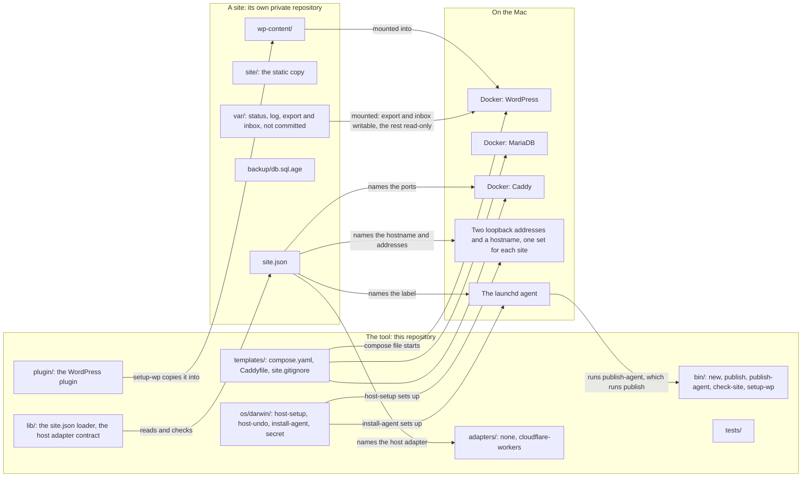
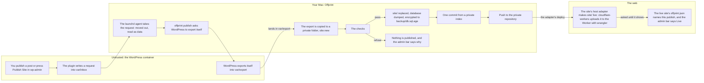
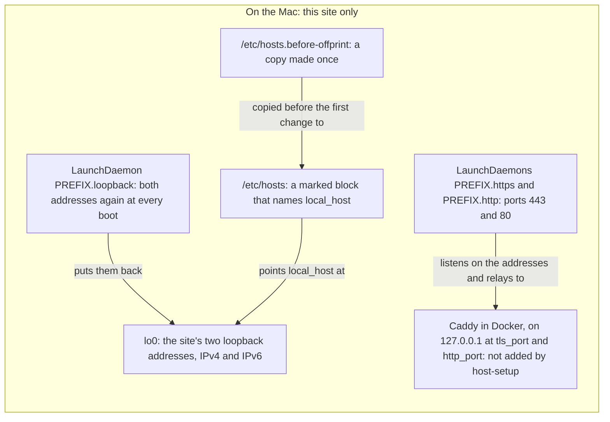

# How the pieces fit together

Two things are kept apart: the tool, which is this repository, and a site, which is its own folder and its own private
git repository. These diagrams show where each thing lives and what happens in a publish. Every box and arrow is true of
the code at the commit this file was written for; where something is not built, the diagram says so.

## What lives where

The tool never holds a site's content, uploads or database dump. A site never holds the tool's code, except one copy of
the plugin that `offprint setup-wp` puts in its `wp-content/mu-plugins/`, and commits. Two of the site folder's
folders are mounted into the WordPress container: `wp-content/`, which it can write, and `var/`, which is read-only to
it but for `var/export` and `var/inbox`. The rest of the site folder (`site.json`, `site/`, `backup/`, its git
repository) is not in the container at all. `site.json` is the one file that names the site's hostname, addresses,
ports, launchd labels and host adapter, and the tool reads it with `lib/config.php` rather than running it. An adapter
is code, so it comes from the tool's `adapters/`, or else from the site folder's own `adapters/`, committed: never from
anywhere WordPress can write. The tests live in the tool's repository and are not part of a site.

## A publish

WordPress is the only part outside your control, so everything it writes is treated as data. The request it leaves in
`var/inbox` is moved out and read as data. The export it writes to `var/export` is copied to a folder it cannot reach
before anything is checked. The checks refuse local addresses, admin, login, XML-RPC and REST links, symlinks and git
files. If they refuse, or anything before them fails, the reason goes to `var/status.json`, which the admin bar shows,
and nothing is published. Only a copy that passed is moved into `site/`, committed from a private index with
`git commit-tree` (so no commit hooks run) and pushed. Then the site's host adapter makes the commit live:
`cloudflare-workers` uploads exactly the committed `site/` to a Cloudflare Worker from this Mac, with the wrangler and
node that `offprint adapter setup` put there and the token it keeps in the login Keychain. The publish asks the live
site for its `offprint.json` until it names this publish, and only then says Live. With no host set up (the adapter
`none`) the publish ends at the push, and says Saved. An adapter for a server you run over SSH is not built.

Step by step:

1. You publish in wp-admin, or press Publish Site. The plugin writes a request into `var/inbox`, and the launchd agent
   (once `offprint install-agent` has installed it) moves it out and reads it as data. The agent runs
   `offprint publish`.
2. WordPress (in Docker, on this Mac) is told to export itself; the exporter runs in the container and writes
   `var/export`. It starts from the home page, the feed, `robots.txt` and the sitemaps (WordPress's own, or those
   `robots.txt` names: see [Plugins that replace WordPress's sitemaps](reference.md#plugins-that-replace-wordpresss-sitemaps)), and
   follows every link. The export is copied to a private folder, `site.new`: WordPress can still write `var/export`, so
   only the private copy is checked and published.
3. `bin/check-site` checks the copy: no local address, no admin, login, XML-RPC or REST links, no symlinks, no git
   files, none of the files the publish or the host writes at the root (for Cloudflare: `offprint.json`, `_headers`
   and `_redirects`), nor one the host would read as its own (`.assetsignore`, `_worker.js`), and the host's limits.
   If it refuses, nothing is published and the admin bar says why.
4. `site/` is replaced by the copy. The database is dumped, and the dump is encrypted with `age` to the public keys
   in `site.json`'s `backup` block, as `backup/db.sql.age`: no readable dump is committed. (See
   [The database backup](reference.md#the-database-backup).)
5. One commit is made of `site/`, `wp-content/` and `backup/`, with `git commit-tree`, so no commit hooks run. It is
   refused unless the plugin in it is exactly this Offprint's own.
6. The commit is pushed to `origin`. Then the site's host adapter makes it live: `cloudflare-workers` uploads exactly
   the committed `site/` to the Worker, from this Mac, with wrangler. The publish asks the live site for its
   `offprint.json` until it names this publish (for Cloudflare, for 60 seconds at most), and then says Live. With no
   host set up (the adapter `none`), the publish ends at the push: "Saved".

Progress is in `var/status.json` (shown in the WordPress admin bar) and `var/publish.log`.

## What `host-setup` adds on the Mac

This is the one step that runs as root, and you run it by hand: `offprint host-setup` prints the `sudo` line. Everything
it writes carries a stamp made from the site folder's path, so it never changes or removes anything that is not this
site's. It refuses before changing anything if an address, the host name, a port or a launchd label is already in use by
something else. `offprint host-undo` takes it all away again, except the `/etc/hosts` copy.
